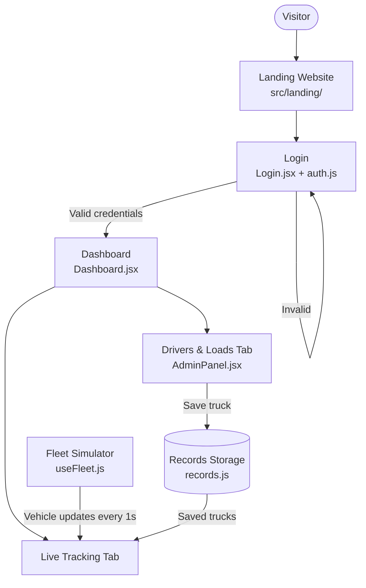
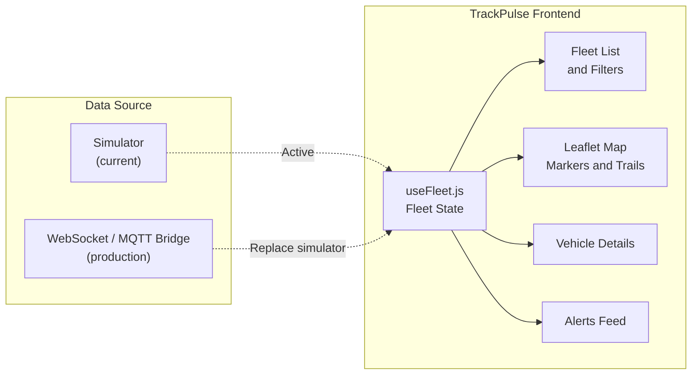
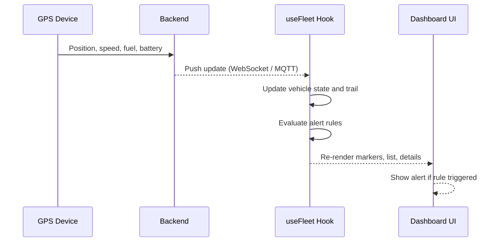

# TrackPulse – Live GPS Tracking Dashboard

Single-page React + Bootstrap app that looks and behaves like a real fleet-tracking product.

## Website structure
- `src/landing/` – marketing site: navbar, hero, Features, How it works, Pricing, About, Contact, Footer
  (all copy, prices, stats and contact details are placeholders – edit them in `Sections.jsx`, `Hero.jsx`, `Footer.jsx`)
- `src/Login.jsx` + `src/auth.js` – admin login (demo: Admin ID `admin123`, password `admin`)
- `src/Dashboard.jsx` – tabs: Live tracking, and Drivers & loads (`components/AdminPanel.jsx`, storage in `src/records.js`). Saved trucks appear on the live map.

## Dashboard features
- Live map (Leaflet) with direction-aware vehicle markers that glide smoothly every second
- Fleet list with search, status filters (Moving / Idle / Offline) and "last seen" times
- Vehicle details: speed gauge, fuel, device battery, heading, coordinates, odometer
- Live alerts feed: over-speeding, low fuel, geofence exit/entry, signal lost / back online
- Trails, follow-mode, dark/light map, fit-all, geofence circle, pause/resume live feed
- Responsive layout (desktop 3-column, tablet 2-column, mobile stacked)

## Run
```bash
npm install
npm run dev      # http://localhost:5173
npm run build    # production build in dist/
```

## Connecting real GPS devices
The simulator lives in `src/hooks/useFleet.js`. Replace its `setInterval` with a
WebSocket (or Socket.IO / MQTT bridge) from your backend and keep the same vehicle shape:

```js
{ id, name, plate, driver, type, pos: [lat, lng], heading, speed, fuel, battery,
  status: 'moving' | 'idle' | 'offline', trail: [[lat, lng], ...], lastUpdate }
```

Change the demo city by editing `CENTER` at the top of `useFleet.js`.

<div align="center">

# 📍 TrackPulse

### Live GPS Tracking Dashboard

A single-page fleet-tracking application built with **React**, **Bootstrap**, and **Leaflet**, featuring a marketing website, secure admin login, and a real-time monitoring dashboard.


</div>

---

## Table of Contents

- [Overview](#overview)
- [Key Features](#key-features)
- [System Architecture](#system-architecture)
- [Project Structure](#project-structure)
- [Getting Started](#getting-started)
- [Demo Credentials](#demo-credentials)
- [Connecting Real GPS Devices](#connecting-real-gps-devices)
- [Configuration](#configuration)
- [Tech Stack](#tech-stack)
- [Roadmap](#roadmap)
- [License](#license)

---

## Overview

TrackPulse is a front-end fleet-management product that looks and behaves like a production tracking platform. It includes:

- **Marketing website** – navbar, hero, features, how it works, pricing, about, contact, and footer.
- **Admin authentication** – login screen guarding the dashboard.
- **Operations dashboard** – live vehicle tracking plus driver and load management.

Vehicle movement is currently driven by a built-in simulator, which can be replaced with a live backend feed (WebSocket, Socket.IO, or MQTT) without changing the UI.

---

## Key Features

### Live Tracking

| Capability | Description |
| --- | --- |
| **Live map** | Leaflet map with direction-aware vehicle markers that glide smoothly every second |
| **Fleet list** | Search, status filters (Moving / Idle / Offline), and "last seen" times |
| **Vehicle details** | Speed gauge, fuel level, device battery, heading, coordinates, and odometer |
| **Alerts feed** | Over-speeding, low fuel, geofence exit/entry, signal lost, and back online |
| **Map controls** | Trails, follow mode, dark/light map, fit-all, geofence circle, pause/resume live feed |

### Operations

- **Drivers & loads** – manage driver and load records; saved trucks appear on the live map.
- **Responsive layout** – 3-column desktop, 2-column tablet, stacked mobile.

---

## System Architecture

### Application Flow



### Data Flow



### Live Update Sequence



---

## Project Structure

```
trackpulse/
├── index.html
├── vite.config.js
├── package.json
└── src/
    ├── main.jsx               # Application entry point
    ├── landing/               # Marketing website
    │   ├── Hero.jsx
    │   ├── Sections.jsx       # Features, How it works, Pricing, About, Contact
    │   └── Footer.jsx
    ├── Login.jsx              # Admin login screen
    ├── auth.js                # Authentication helpers
    ├── Dashboard.jsx          # Dashboard shell and tabs
    ├── records.js             # Driver and load storage
    ├── components/
    │   └── AdminPanel.jsx     # Drivers & loads management
    └── hooks/
        └── useFleet.js        # Fleet state and GPS simulator
```

---

## Getting Started

### Prerequisites

- Node.js 18 or later
- npm (or yarn / pnpm)

### Installation and Run

```bash
# Install dependencies
npm install

# Start the development server
npm run dev        # http://localhost:5173

# Create a production build
npm run build      # output in dist/

# Preview the production build locally
npm run preview
```

---

## Demo Credentials

| Field | Value |
| --- | --- |
| Admin ID | `admin123` |
| Password | `admin` |

> ⚠️ **For demonstration only.** Replace the client-side authentication with a secure, server-side solution before any production deployment.

---

## Connecting Real GPS Devices

The simulator lives in `src/hooks/useFleet.js`. To use live data, replace its `setInterval` with a WebSocket (or Socket.IO / MQTT bridge) connection to your backend, and keep the same vehicle shape:

```js
{
  id, name, plate, driver, type,
  pos: [lat, lng],
  heading, speed, fuel, battery,
  status: 'moving' | 'idle' | 'offline',
  trail: [[lat, lng], ...],
  lastUpdate
}
```

---

## Configuration

| Setting | Location | Purpose |
| --- | --- | --- |
| `CENTER` | top of `src/hooks/useFleet.js` | Sets the demo city / initial map center |
| Landing copy, prices, stats | `Sections.jsx`, `Hero.jsx` | Marketing content (placeholders) |
| Contact details | `Footer.jsx` | Footer information (placeholders) |

---

## Tech Stack

| Layer | Technology |
| --- | --- |
| UI framework | React (JSX) |
| Styling | Bootstrap |
| Mapping | Leaflet |
| Build tool | Vite with `@vitejs/plugin-react` |

---

## Roadmap

- [ ] Backend integration (WebSocket / MQTT)
- [ ] Server-side authentication and role-based access
- [ ] Trip history and route playback
- [ ] Multiple geofences with custom shapes
- [ ] Exportable reports

---

## License

Add your license here (for example, MIT) and include a `LICENSE` file in the repository.
